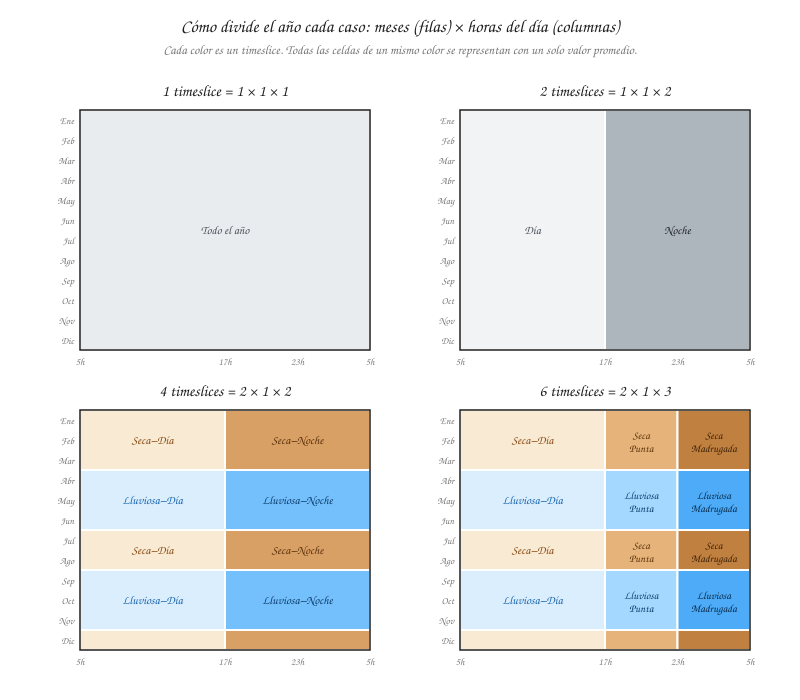
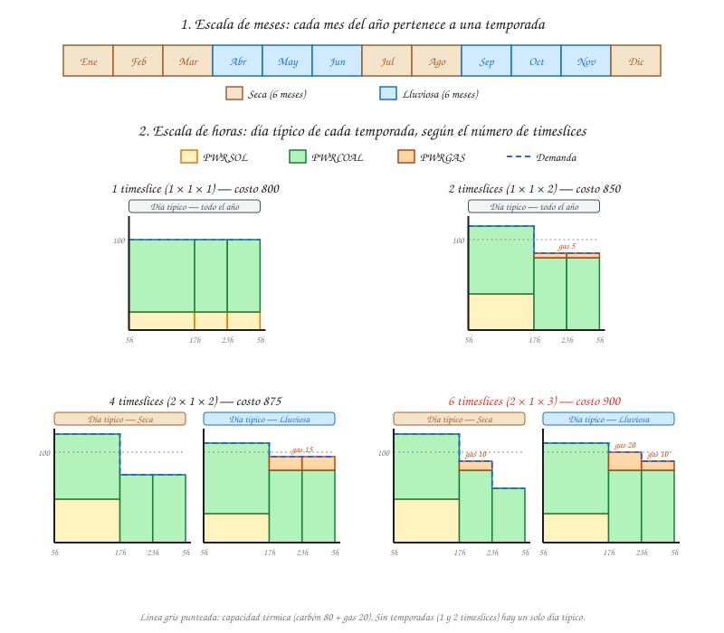

# Quickstart 4 — Timeslices y energía solar

Los quickstarts anteriores usaron un solo timeslice (`ANNUAL`): el modelo veía el año como un único bloque con demanda constante. Ese supuesto funciona mientras todas las tecnologías puedan producir igual en cualquier momento. Deja de funcionar cuando entra una fuente no convencional de energía renovable (FNCER), como la solar, que solo produce cuando hay sol y produce más en unas temporadas que en otras. Este recorrido agrega una planta solar al sistema del [Quickstart 1](quickstart-1-oferta-demanda.md) y resuelve el mismo despacho con 1, 2, 4 y 6 timeslices para ver cómo cambia la respuesta.

!!! warning "Cifras ilustrativas"
    Igual que en los quickstarts anteriores, los números están elegidos para que la aritmética sea verificable a mano. Se usa un solo año (2025), sin inversión ni descuento, para aislar la lógica del despacho por timeslices.

## Concepto y estructura

En lugar de modelar las 8 760 horas del año de forma continua, lo que aumentaría mucho el tiempo de cómputo, OSeMOSYS agrupa el año con una combinación jerárquica de tres conjuntos:

- **Temporadas** (`SEASON`): divisiones del año con clima o demanda parecidos. En Colombia, por ejemplo, **Seca** y **Lluviosa**.
- **Tipos de día** (`DAYTYPE`): clasificación dentro de cada temporada, por ejemplo días laborables frente a fines de semana y festivos.
- **Franjas horarias** (`DAILYTIMEBRACKET`): momentos del día, por ejemplo **Día** y **Noche**, o bloques de 4 a 6 horas.

El número total de timeslices es el producto de las tres dimensiones:

$$
\text{Timeslices} = \text{Temporadas} \times \text{Tipos de día} \times \text{Franjas horarias}
$$

Este recorrido usa un solo tipo de día y varía las otras dos dimensiones:

| Caso | Temporadas | Tipos de día | Franjas horarias | Timeslices |
|---|---|---|---|---|
| 1 | 1 (Año) | 1 | 1 (Todo el día) | 1 × 1 × 1 = **1** |
| 2 | 1 (Año) | 1 | 2 (Día, Noche) | 1 × 1 × 2 = **2** |
| 3 | 2 (Seca, Lluviosa) | 1 | 2 (Día, Noche) | 2 × 1 × 2 = **4** |
| 4 | 2 (Seca, Lluviosa) | 1 | 3 (Día, Punta, Madrugada) | 2 × 1 × 3 = **6** |

Cada caso es una versión más detallada del anterior: la franja **Noche** de los casos 2 y 3 se divide en **Punta** y **Madrugada** en el caso 4, y el **Año** del caso 2 se divide en **Seca** y **Lluviosa** en el caso 3.

La figura muestra cómo cada caso reparte las horas del año. Las filas son los meses y las columnas, las horas del día. Todas las celdas del mismo color forman un solo timeslice, y el modelo las representa con un único valor promedio de demanda y de disponibilidad solar.

Las temporadas y las franjas trabajan en escalas distintas. La temporada agrupa **meses**, que no tienen que ser consecutivos: en Colombia el régimen es bimodal, y la temporada Seca reúne diciembre–marzo y julio–agosto. La franja agrupa **horas** dentro de cada día. Ninguna de las dos cambia de un año a otro del horizonte: la misma partición se repite en cada año modelado.

!!! note "Cómo los usa OSeMOSYS"
    El conjunto que entra en las ecuaciones de balance y capacidad es `TIMESLICE`. Cada timeslice se asigna a una temporada, un tipo de día y una franja con los parámetros `Conversionls`, `Conversionld` y `Conversionlh`, que el modelo usa sobre todo en las ecuaciones de almacenamiento. Para el despacho de esta página basta con saber cuánto dura cada timeslice (`YearSplit`).

## Caso de ejemplo

Se retoma el despacho de 2025 del [Quickstart 1](quickstart-1-oferta-demanda.md) y se agrega una tecnología:

| Tecnología | Capacidad | `VariableCost` | `EmissionActivityRatio` | Disponibilidad |
|---|---|---|---|---|
| `PWRSOL` (solar, ya instalada) | 80 | 0 $/unidad | 0 t CO₂/unidad | Solo en la franja Día, según `CapacityFactor` |
| `PWRCOAL` | 80 | 10 $/unidad | 0.9 t CO₂/unidad | Siempre |
| `PWRGAS` | 20 | 30 $/unidad | 0.4 t CO₂/unidad | Siempre |

La temporada **Seca** agrupa los meses de diciembre a marzo y de julio a agosto, y la **Lluviosa**, los de abril a junio y de septiembre a noviembre. Cada una suma seis meses, es decir, medio año. Las franjas tienen esta duración:

| Franja | Horas | Fracción del día |
|---|---|---|
| Día | 5–17 h | 12 h = 1/2 |
| Punta | 17–23 h | 6 h = 1/4 |
| Madrugada | 23–5 h | 6 h = 1/4 |

La duración de cada timeslice como fracción del año (`YearSplit`) es la fracción de la temporada multiplicada por la fracción del día. Por ejemplo, Seca–Día: 1/2 × 1/2 = 1/4.

Con el máximo detalle (caso 4, 6 timeslices), los datos son:

| Timeslice | `YearSplit` | Demanda (tasa) | `CapacityFactor` solar | Solar disponible (80 × CF) |
|---|---|---|---|---|
| Seca–Día | 1/4 | 120 | 0.6 | 48 |
| Seca–Punta | 1/8 | 90 | 0 | 0 |
| Seca–Madrugada | 1/8 | 60 | 0 | 0 |
| Lluviosa–Día | 1/4 | 110 | 0.4 | 32 |
| Lluviosa–Punta | 1/8 | 100 | 0 | 0 |
| Lluviosa–Madrugada | 1/8 | 90 | 0 | 0 |
| **Promedio anual** | **1** | **100** | **0.25** | **20** |

- En temporada seca hay más sol (CF 0.6 en el día) y más demanda de día, por el calor.
- En temporada lluviosa hay menos sol (CF 0.4) y la demanda de la noche es más alta.
- La demanda anual sigue siendo 100, como en el Quickstart 1, y la solar produce 20 en el año en todos los casos. Lo único que cambia es cuántos timeslices ve el modelo.

## Cómo entran los timeslices en las ecuaciones

Con varios timeslices, el balance y el límite de capacidad del [Quickstart 1](quickstart-1-oferta-demanda.md) dejan de escribirse una vez por año y se escriben **una vez por cada timeslice** $l$:

$$
\text{RateOfDemand}[l,y] = \frac{\text{SpecifiedAnnualDemand}[y] \times \text{SpecifiedDemandProfile}[l,y]}{\text{YearSplit}[l,y]}
$$

$$
\sum_{t} \text{RateOfProductionByTechnology}[l,t,y] \geq \text{RateOfDemand}[l,y] \qquad \text{para cada timeslice } l
$$

$$
\text{RateOfActivity}[l,t,y] \leq \text{TotalCapacityAnnual}[t,y] \times \text{CapacityFactor}[t,l,y] \qquad \text{para cada } t \text{ y cada } l
$$

- `SpecifiedDemandProfile` es la fracción de la demanda anual que cae en cada timeslice. Dividida por `YearSplit`, da la tasa de demanda del timeslice (la columna "Demanda" de la tabla de arriba).
- `CapacityFactor` es lo que hace distinta a la solar: para `PWRCOAL` y `PWRGAS` vale 1 en todos los timeslices; para `PWRSOL` vale 0 en Punta y Madrugada, y cambia según la temporada.

La energía de cada timeslice es la tasa multiplicada por `YearSplit`, y el costo anual es la suma de los costos de todos los timeslices. Cuando el modelo tiene menos timeslices, la demanda y el `CapacityFactor` de cada uno son el **promedio**, ponderado por duración, de los momentos que agrupa. Ahí está todo el efecto que muestra este recorrido.

## Caso 1: 1 timeslice

Con un solo timeslice, el modelo ve una demanda constante de 100 y una solar disponible de forma constante, 80 × 0.25 = 20, las 24 horas del año.

1. `PWRSOL` (costo 0) produce sus 20.
2. Quedan 80. `PWRCOAL` los produce todos.
3. `PWRGAS` no se necesita.

$$
\text{Costo} = 80 \times 10 = 800
$$

Con este nivel de detalle, la solar parece desplazar todo el gas: frente al Quickstart 1 (`PWRGAS` = 20, costo 1 400), el gas desaparece.

## Caso 2: 2 timeslices (Día y Noche)

Una temporada, un tipo de día y dos franjas: **Día** (5–17 h) y **Noche** (17–5 h), cada una con `YearSplit` = 1/2. Cada franja promedia las dos temporadas.

| Timeslice | Demanda (promedio) | CF solar (promedio) | `PWRSOL` | `PWRCOAL` | `PWRGAS` |
|---|---|---|---|---|---|
| Día | (120 + 110) / 2 = 115 | (0.6 + 0.4) / 2 = 0.5 | 40 | 75 | 0 |
| Noche | (90 + 60 + 100 + 90) / 4 = 85 | 0 | 0 | 80 | 5 |

De día, la solar (40) desplaza al **carbón**: en esa franja el carbón ya alcanza a cubrir el resto y el gas no se necesita. De noche no hay sol, y el gas vuelve a entrar.

$$
\begin{aligned}
\text{PWRCOAL} &= 75 \times \tfrac{1}{2} + 80 \times \tfrac{1}{2} = 77.5 \\
\text{PWRGAS} &= 0 \times \tfrac{1}{2} + 5 \times \tfrac{1}{2} = 2.5 \\
\text{Costo} &= 77.5 \times 10 + 2.5 \times 30 = 850
\end{aligned}
$$

## Caso 3: 4 timeslices (2 temporadas × 2 franjas)

El año se divide en **Seca** y **Lluviosa**, cada una con Día y Noche. Cada timeslice dura 1/2 × 1/2 = 1/4 del año.

| Timeslice | Demanda | CF solar | `PWRSOL` | `PWRCOAL` | `PWRGAS` |
|---|---|---|---|---|---|
| Seca–Día | 120 | 0.6 | 48 | 72 | 0 |
| Seca–Noche | (90 + 60) / 2 = 75 | 0 | 0 | 75 | 0 |
| Lluviosa–Día | 110 | 0.4 | 32 | 78 | 0 |
| Lluviosa–Noche | (100 + 90) / 2 = 95 | 0 | 0 | 80 | 15 |

La temporada lluviosa estaba escondida dentro del promedio anual. Ahora el modelo ve dos cosas: la solar produce menos en esa temporada (32 en vez de 48), y las noches lluviosas tienen más demanda. Todo el gas se concentra en Lluviosa–Noche.

$$
\begin{aligned}
\text{PWRCOAL} &= \tfrac{72 + 75 + 78 + 80}{4} = 76.25 \\
\text{PWRGAS} &= \tfrac{0 + 0 + 0 + 15}{4} = 3.75 \\
\text{Costo} &= 76.25 \times 10 + 3.75 \times 30 = 875
\end{aligned}
$$

## Caso 4: 6 timeslices (2 temporadas × 3 franjas)

La Noche se divide en **Punta** (17–23 h) y **Madrugada** (23–5 h). Los timeslices de Día duran 1/4 del año, y los de Punta y Madrugada, 1/2 × 1/4 = 1/8.

| Timeslice | `YearSplit` | Demanda | `PWRSOL` | `PWRCOAL` | `PWRGAS` |
|---|---|---|---|---|---|
| Seca–Día | 1/4 | 120 | 48 | 72 | 0 |
| Seca–Punta | 1/8 | 90 | 0 | 80 | 10 |
| Seca–Madrugada | 1/8 | 60 | 0 | 60 | 0 |
| Lluviosa–Día | 1/4 | 110 | 32 | 78 | 0 |
| Lluviosa–Punta | 1/8 | 100 | 0 | 80 | 20 |
| Lluviosa–Madrugada | 1/8 | 90 | 0 | 80 | 10 |

La punta de 17–23 h estaba promediada con la madrugada, que tiene poca demanda. Separada, la punta necesita gas también en temporada seca, y en temporada lluviosa las dos térmicas operan al máximo.

$$
\begin{aligned}
\text{PWRCOAL} &= 72 \times \tfrac{1}{4} + 80 \times \tfrac{1}{8} + 60 \times \tfrac{1}{8} + 78 \times \tfrac{1}{4} + 80 \times \tfrac{1}{8} + 80 \times \tfrac{1}{8} = 75 \\
\text{PWRGAS} &= (10 + 20 + 10) \times \tfrac{1}{8} = 5 \\
\text{Costo} &= 75 \times 10 + 5 \times 30 = 900
\end{aligned}
$$

La figura resume los cuatro casos en las dos escalas: arriba, a qué temporada pertenece cada mes; abajo, el despacho del día típico de cada temporada. Con 1 y 2 timeslices no hay temporadas, así que hay un solo día típico para todo el año.

## Comparación

| | 1 timeslice | 2 timeslices | 4 timeslices | 6 timeslices |
|---|---|---|---|---|
| Estructura | 1 × 1 × 1 | 1 × 1 × 2 | 2 × 1 × 2 | 2 × 1 × 3 |
| `PWRSOL` | 20 | 20 | 20 | 20 |
| `PWRCOAL` | 80 | 77.5 | 76.25 | 75 |
| `PWRGAS` | 0 | 2.5 | 3.75 | 5 |
| **Costo** | **800** | **850** | **875** | **900** |
| Emisiones (t CO₂) | 72 | 70.75 | ≈ 70.1 | 69.5 |

La solar produce lo mismo en las cuatro columnas (20). Lo que cambia es **a quién desplaza**:

- Con 1 timeslice, el modelo supone que la solar está disponible a toda hora y en todas las temporadas, así que parece desplazar todo el gas.
- Con más timeslices, el modelo ve que la solar produce de día, cuando el carbón ya es la tecnología marginal. La solar desplaza carbón (10 $/unidad), y el gas sigue siendo necesario en las noches, sobre todo en la temporada lluviosa.

Cada dimensión revela algo distinto:

- Las **franjas horarias** separan el día de la noche: muestran que la solar no ayuda en las horas sin sol (caso 2) y que la punta es más exigente que el promedio de la noche (caso 4).
- Las **temporadas** separan la época de más sol de la de menos sol: muestran que la noche lluviosa es el momento más difícil para el sistema (caso 3).

El costo sube un 12.5 % (de 800 a 900) sin que cambie ni la demanda anual ni el parque de generación. El modelo con 1 timeslice no se equivoca en la aritmética: le falta información sobre **cuándo** se produce y **cuándo** se consume.

Las emisiones bajan con más detalle, porque la solar desplaza carbón (0.9 t CO₂/unidad) en vez de gas (0.4 t CO₂/unidad). Con una meta de emisiones como la del [Quickstart 3](quickstart-3-restricciones-politica.md), el número de timeslices también cambiaría el costo de cumplirla.

### Suficiencia de capacidad

Con 1 timeslice, las térmicas operan a 80 de 100: parece que sobra capacidad. Con 6 timeslices, en Lluviosa–Punta operan a 100 de 100, sin ningún margen. Si la demanda de ese timeslice subiera a 105, el modelo con 1 timeslice no vería ningún problema, y el de 6 timeslices tendría que invertir en capacidad nueva (como en el [Quickstart 2](quickstart-2-expansion-capacidad.md)). La solar no ayuda en esas horas, por mucha capacidad que se instale.

### El tipo de día

Este recorrido usa un solo tipo de día. Agregar **Laborable** y **Festivo** separaría los días de semana, con más demanda, de los fines de semana y festivos, con menos. Con 2 temporadas × 2 tipos de día × 3 franjas, el modelo tendría 12 timeslices. La lógica es la misma: cada dimensión nueva deja de promediar momentos que el sistema vive de forma distinta.

## Relación con la aplicación real

Más timeslices dan un despacho más fiel, pero también un problema más grande: cada timeslice repite las ecuaciones de balance y de capacidad para todas las tecnologías, regiones y años. Por eso la plataforma permite elegir el nivel de detalle:

- Al crear o importar un escenario, la opción de **colapsar todo a 1 timeslice** está activada por defecto. Desmarcarla conserva los timeslices definidos en los datos de entrada (ver [Escenarios y catálogos](../user-guide/escenarios.md)).
- El nombre de los [archivos SAND](../examples/sand-files.md) indica cuántos timeslices trae cada escenario (por ejemplo, `2TS`).
- Con timeslices desagregados, el problema necesita más recursos de cómputo (ver [Requisitos y solvers](requisitos.md)).

La regla práctica que deja este ejemplo: con un sistema dominado por tecnologías despachables, pocos timeslices pueden ser suficientes. A medida que crece la participación de solar y eólica, el número de timeslices empieza a cambiar el resultado, porque su valor depende de **en qué momento** y **en qué temporada** producen.

## Siguiente paso

Para ver el mismo tipo de problema resuelto en la interfaz con datos reales, continúe con [Primera simulación](../examples/first-simulation.md).
